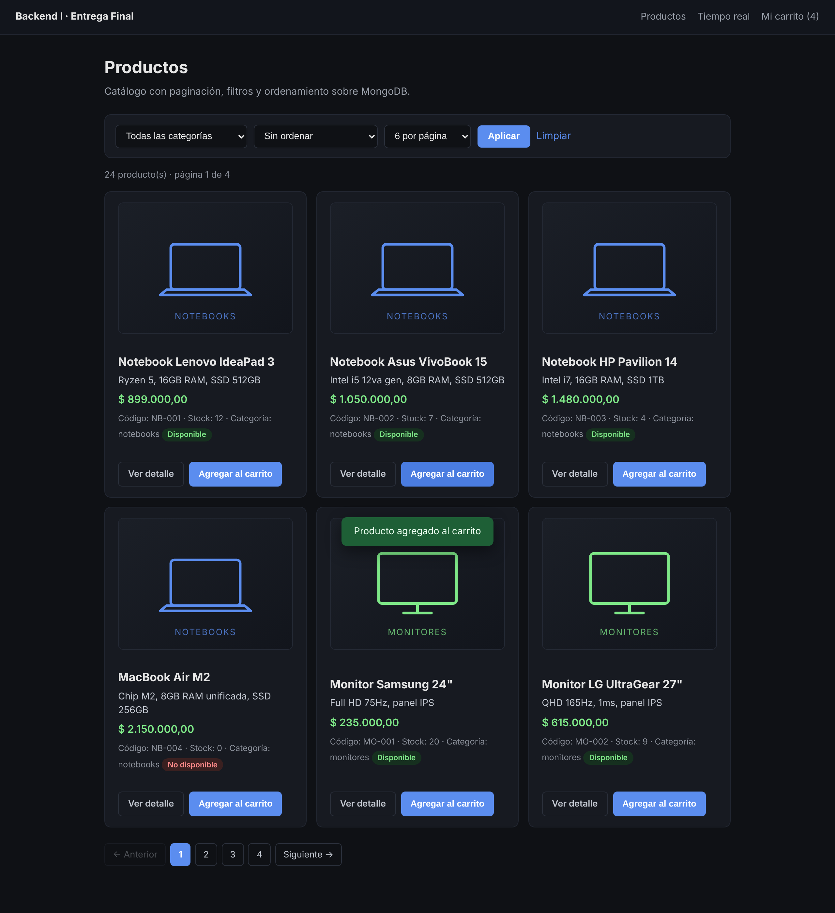
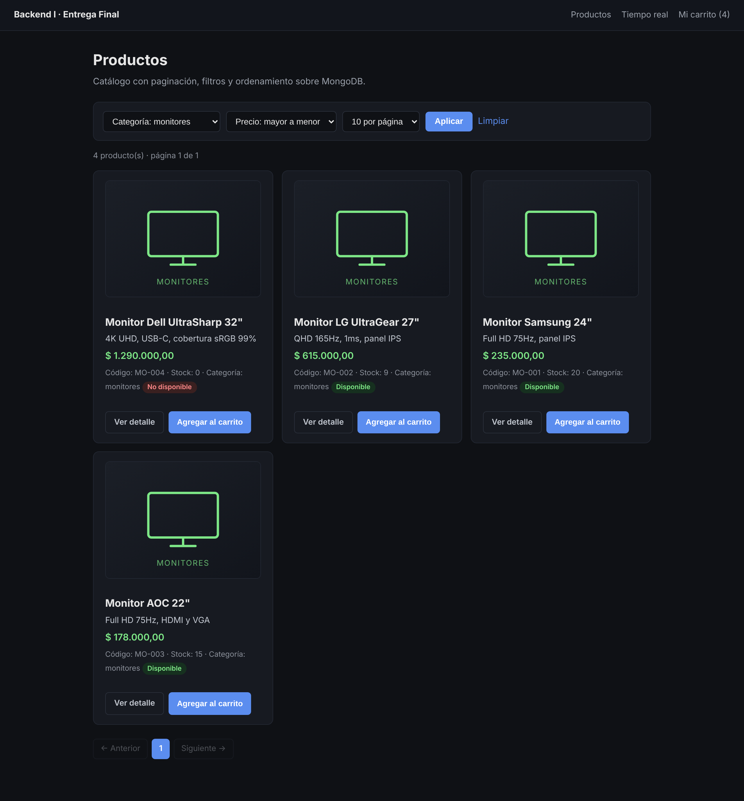
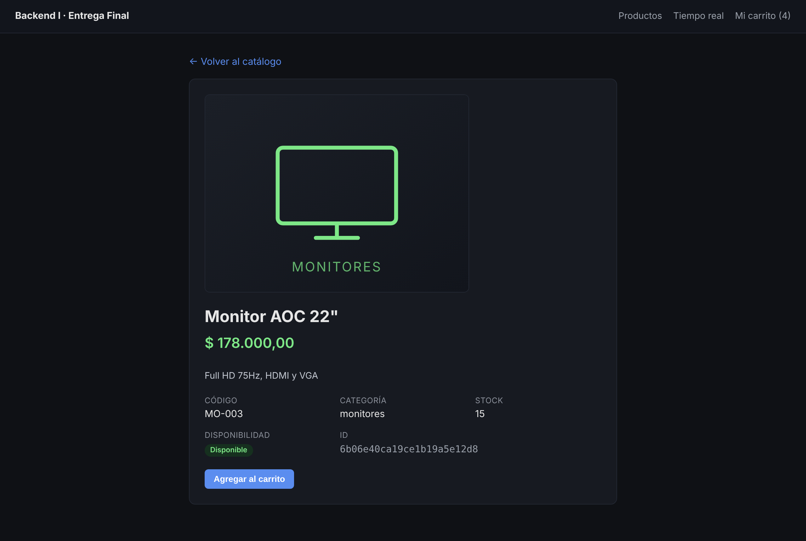
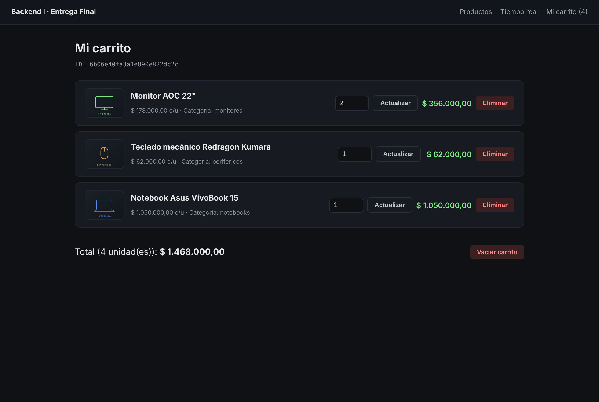
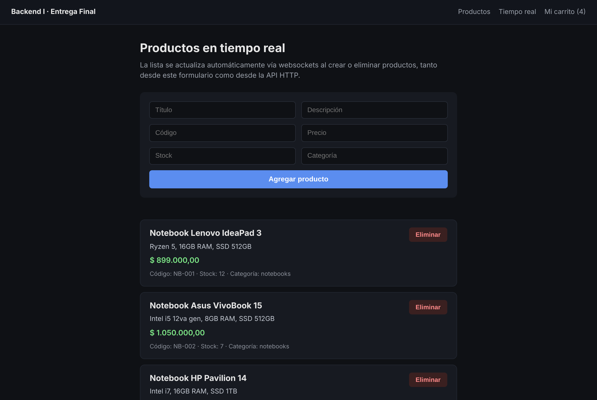

# Entrega Final - Programación Backend I

**Alumno:** Agustín Idoyaga Molina
**Curso:** Programación Backend I: Desarrollo avanzado de Backend (CoderHouse) — Comisión 95940

Servidor de Node.js y Express que gestiona **productos** y **carritos** a través de una API REST,
con **MongoDB (Mongoose)** como persistencia principal, vistas en **Handlebars** y actualización en
tiempo real con **Socket.io**.

## Contenido

- [Cumplimiento de la consigna](#cumplimiento-de-la-consigna)
- [Instalación y ejecución](#instalación-y-ejecución)
- [Tests (evidencia automática)](#tests-evidencia-automática)
- [Colección de Postman](#colección-de-postman)
- [API de productos](#api-de-productos--apiproducts)
- [API de carritos](#api-de-carritos--apicarts)
- [Respuestas de error](#respuestas-de-error)
- [Vistas](#vistas-handlebars)
- [WebSockets](#websockets-socketio)
- [Correcciones aplicadas](#correcciones-aplicadas)
- [Estructura del proyecto](#estructura-del-proyecto)

## Cumplimiento de la consigna

Cada punto de la consigna, dónde está resuelto y con qué se puede comprobar. Los tests se corren con
`npm test` ([ver salida](#tests-evidencia-automática)) y las capturas están en [`docs/capturas`](docs/capturas).

### Objetivos generales y formato

| Consigna | Dónde está | Cómo verificarlo |
| --- | --- | --- |
| Mongo como sistema de persistencia principal | [`src/config/database.js`](src/config/database.js), [`src/models/`](src/models) | Todos los tests corren contra MongoDB |
| Todos los endpoints para trabajar con productos y carritos | [`src/routes/products.router.js`](src/routes/products.router.js), [`src/routes/carts.router.js`](src/routes/carts.router.js) | [`test/products.test.js`](test/products.test.js), [`test/carts.test.js`](test/carts.test.js), colección de Postman |
| Link al repositorio sin `node_modules` | [`.gitignore`](.gitignore) | `node_modules/` no está en el repositorio |
| Comentarios en el código | Todos los archivos de `src/` | — |
| La lógica de negocio no cambia, sólo la persistencia | [`src/managers/`](src/managers): mismos métodos que en las entregas anteriores, ahora sobre Mongoose | — |
| Se conserva lo de las entregas anteriores: CRUD de productos, carritos (`POST /`, `GET /:cid`, `POST /:cid/product/:pid`) y vista `/realtimeproducts` con websockets | Mismos routers y [`socketManager.js`](src/sockets/socketManager.js) | Tests de [`test/products.test.js`](test/products.test.js), [`test/carts.test.js`](test/carts.test.js) y [`test/sockets.test.js`](test/sockets.test.js) |

### Productos: `GET /api/products`

| Consigna | Dónde está | Cómo verificarlo |
| --- | --- | --- |
| Recibe por query params `limit`, `page`, `sort` y `query`, todos opcionales | [`ProductManager.getPaginatedProducts`](src/managers/ProductManager.js) | Test *"devuelve el objeto con el formato pedido, con limit 10 y page 1 por defecto"* |
| `limit`: cantidad de elementos; si no se recibe, 10 | `parsePositiveInteger(limit, "limit", 10)` | Tests *"…limit 10 y page 1 por defecto"* y *"limit devuelve sólo la cantidad de elementos solicitada"* |
| `page`: página a devolver; si no se recibe, 1 | `parsePositiveInteger(page, "page", 1)` | Test *"page devuelve la página solicitada"* |
| `query`: filtro a aplicar; si no se recibe, búsqueda general | `buildFilter()` en [`ProductManager.js`](src/managers/ProductManager.js) | Tests *"query busca por categoría…"* y *"query busca por disponibilidad…"* |
| `sort`: `asc`/`desc` por precio; si no se recibe, sin ordenamiento | `buildSort()` en [`ProductManager.js`](src/managers/ProductManager.js) | Tests *"sort=asc…"*, *"sort=desc…"* y *"sin sort no realiza ningún ordenamiento"* |
| Respuesta `{ status, payload, totalPages, prevPage, nextPage, page, hasPrevPage, hasNextPage, prevLink, nextLink }` | [`products.router.js`](src/routes/products.router.js) | Test del formato (compara las claves exactas) y [ejemplo real](#formato-de-respuesta) |
| `prevLink` / `nextLink`: link directo, `null` si no hay página | `buildPageLink()` en [`src/utils/pagination.js`](src/utils/pagination.js) | Test *"combina filtro, orden y paginación, y los links conservan limit, sort y query"* (usa el link tal cual) |
| Buscar por categoría o por disponibilidad y ordenar por precio | `?query=category:<cat>`, `?query=status:true\|false`, `?sort=asc\|desc` | Captura [`02-filtro-categoria-orden-precio.png`](docs/capturas/02-filtro-categoria-orden-precio.png) |

### Carritos

| Consigna | Dónde está | Cómo verificarlo |
| --- | --- | --- |
| `DELETE api/carts/:cid/products/:pid` elimina del carrito el producto seleccionado | `removeProductFromCart` en [`CartManager.js`](src/managers/CartManager.js) | Test *"DELETE /:cid/products/:pid elimina del carrito sólo el producto seleccionado"* |
| `PUT api/carts/:cid` actualiza todos los productos con un arreglo de productos | `updateCartProducts` | Tests *"PUT /:cid actualiza todos los productos…"* y *"…acepta el arreglo directo en el body"* |
| `PUT api/carts/:cid/products/:pid` actualiza **sólo** la cantidad, con la cantidad de `req.body` | `updateProductQuantity` | Test *"PUT /:cid/products/:pid actualiza SÓLO la cantidad, con la cantidad de req.body"* |
| `DELETE api/carts/:cid` elimina todos los productos del carrito | `clearCart` | Test *"DELETE /:cid elimina todos los productos del carrito"* |
| En el modelo de Carts, `products` guarda el id del producto con referencia a Products, y `GET /:cid` los trae completos con `populate` | [`src/models/cart.model.js`](src/models/cart.model.js), `getCartById` | Test *"GET /:cid trae los productos completos con populate, guardando sólo el id en la base"* (revisa la respuesta y el documento guardado) |

### Vistas

| Consigna | Dónde está | Cómo verificarlo |
| --- | --- | --- |
| `index.handlebars` en `/products` muestra todos los productos con su paginación | [`src/views/index.handlebars`](src/views/index.handlebars), [`views.router.js`](src/routes/views.router.js) | Test *"muestra los productos con su paginación"*, captura [`01-catalogo-paginado.png`](docs/capturas/01-catalogo-paginado.png) |
| Vista con el producto seleccionado (`/products/:pid`): descripción, precio, categoría, etc. y botón para agregar al carrito | [`src/views/productDetail.handlebars`](src/views/productDetail.handlebars) | Test *"muestra el producto con descripción, precio, categoría y botón de agregar al carrito"*, captura [`03-detalle-producto.png`](docs/capturas/03-detalle-producto.png) |
| Botón "agregar al carrito" directamente, sin abrir el detalle | Botón en cada tarjeta de `index.handlebars` + [`public/js/cart.js`](public/js/cart.js) | Test *"cada producto tiene link a su detalle y botón para agregarlo al carrito directamente"*, captura 01 |
| Vista `/carts/:cid` que lista **sólo** los productos de ese carrito | [`src/views/cart.handlebars`](src/views/cart.handlebars) | Test *"lista SÓLO los productos que pertenecen a ese carrito"* (con otro carrito en la base), captura [`04-carrito.png`](docs/capturas/04-carrito.png) |

## Instalación y ejecución

### Requisitos

- **Node.js 18.18 o superior** (probado con Node 18, 20 y 22)
- **MongoDB** local o en Atlas (para los tests no hace falta: usan una base en memoria)

### Pasos

```bash
# 1. Instalar dependencias
npm install

# 2. Configurar la conexión a la base (editar MONGO_URI si hace falta)
cp .env.example .env

# 3. Cargar 24 productos de ejemplo (opcional, recomendado para probar la paginación)
npm run seed

# 4. Levantar el servidor
npm start          # o npm run dev para reiniciar con cada cambio
```

El servidor queda en **http://localhost:8080** y la home redirige al catálogo (`/products`).

| Variable | Descripción | Valor por defecto |
| --- | --- | --- |
| `MONGO_URI` | URI de conexión a MongoDB | `mongodb://127.0.0.1:27017/entregaFinal` |
| `PORT` | Puerto del servidor | `8080` |

> `npm run seed` borra los productos y carritos existentes y carga los productos de ejemplo.

## Tests (evidencia automática)

```bash
npm test
```

39 tests con Mocha, Chai y Supertest cubren cada punto de la consigna: paginación, filtros,
ordenamiento y formato de respuesta de productos, todos los endpoints de carritos (incluido el
`populate`), las vistas y los websockets.

No hace falta tener MongoDB instalado: los tests levantan una base en memoria con
`mongodb-memory-server` (la primera vez descarga MongoDB, puede tardar un poco). Para usar otra base,
definir `MONGO_URI_TEST`. Ojo: esa base se vacía en cada test.

```
  API de carritos (/api/carts)
    ✔ POST / crea un carrito con id autogenerado y sin productos
    ✔ POST /:cid/products/:pid agrega el producto y, si ya estaba, suma la cantidad
    ✔ GET /:cid trae los productos completos con populate, guardando sólo el id en la base
    ✔ DELETE /:cid/products/:pid elimina del carrito sólo el producto seleccionado
    ✔ PUT /:cid actualiza todos los productos del carrito con un arreglo de productos
    ✔ PUT /:cid también acepta el arreglo directo en el body
    ✔ PUT /:cid/products/:pid actualiza SÓLO la cantidad, con la cantidad de req.body
    ✔ DELETE /:cid elimina todos los productos del carrito (el carrito sigue existiendo)
    ✔ responde 404 si el carrito o el producto no existen, y 400 si el id no es válido
    ✔ valida la cantidad: tiene que ser un entero mayor o igual a 1
    ✔ PUT /:cid no modifica el carrito si algún producto del arreglo no existe

  API de productos (/api/products)
    GET / con paginación, filtros y ordenamiento
      ✔ devuelve el objeto con el formato pedido, con limit 10 y page 1 por defecto
      ✔ limit devuelve sólo la cantidad de elementos solicitada
      ✔ page devuelve la página solicitada
      ✔ sin sort no realiza ningún ordenamiento (respeta el orden de carga)
      ✔ sort=asc ordena por precio de menor a mayor
      ✔ sort=desc ordena por precio de mayor a menor
      ✔ query busca por categoría (category:<categoría> o sólo la categoría)
      ✔ query busca por disponibilidad (status:true / status:false)
      ✔ combina filtro, orden y paginación, y los links conservan limit, sort y query
      ✔ responde status: error con parámetros inválidos o una página que no existe
    GET, POST, PUT y DELETE de un producto
      ✔ GET /:pid devuelve sólo el producto con ese id
      ✔ GET /:pid responde 404 si no existe y 400 si el id no es válido
      ✔ POST / crea el producto con id autogenerado y status true por defecto
      ✔ POST / valida campos obligatorios, tipos y que el código no se repita
      ✔ PUT /:pid actualiza los campos enviados sin modificar el id
      ✔ PUT /:pid rechaza valores inválidos con 400
      ✔ DELETE /:pid elimina el producto y lo saca de los carritos que lo tenían

  Websockets (/realtimeproducts)
    ✔ newProduct crea el producto y emite la lista actualizada
    ✔ deleteProduct elimina el producto y emite la lista actualizada
    ✔ informa con errorMessage si el producto enviado no es válido
    ✔ un alta hecha por la API HTTP también actualiza a los clientes conectados

  Vistas (Handlebars)
    /products (index.handlebars)
      ✔ muestra los productos con su paginación
      ✔ cada producto tiene link a su detalle y botón para agregarlo al carrito directamente
      ✔ respeta los mismos query params que la API (query, sort y limit)
    /products/:pid (detalle)
      ✔ muestra el producto con descripción, precio, categoría y botón de agregar al carrito
      ✔ muestra una página de error si el producto no existe
    /carts/:cid
      ✔ lista SÓLO los productos que pertenecen a ese carrito
      ✔ muestra una página de error si el carrito no existe

  39 passing
```

## Colección de Postman

[`docs/EntregaFinal-BackendI.postman_collection.json`](docs/EntregaFinal-BackendI.postman_collection.json)
tiene un request por cada endpoint, con tests automáticos en cada uno.

1. Con la base cargada (`npm run seed`) y el servidor levantado (`npm start`), importar el archivo en Postman.
2. Correrla completa con el **Runner** (en orden: cada request guarda los ids que usa la siguiente).

Resultado: 17 requests y 35 asserts, todos aprobados. También se puede correr desde la terminal:

```bash
npx newman run docs/EntregaFinal-BackendI.postman_collection.json
```

## API de productos — `/api/products`

| Método | Ruta | Descripción |
| --- | --- | --- |
| `GET` | `/` | Lista paginada, filtrada y ordenada |
| `GET` | `/:pid` | Devuelve el producto con ese id |
| `POST` | `/` | Crea un producto (id autogenerado por MongoDB) |
| `PUT` | `/:pid` | Actualiza los campos enviados, sin modificar el id |
| `DELETE` | `/:pid` | Elimina el producto (y lo saca de los carritos que lo tenían) |

### Query params de `GET /api/products`

| Param | Valores | Si no se envía | Descripción |
| --- | --- | --- | --- |
| `limit` | entero ≥ 1 | `10` | Cantidad de elementos por página |
| `page` | entero ≥ 1 | `1` | Página solicitada |
| `sort` | `asc` / `desc` | sin ordenamiento | Ordena por precio |
| `query` | ver abajo | búsqueda general | Filtra por categoría o por disponibilidad |

| `query` | Filtro aplicado |
| --- | --- |
| `category:monitores` (o sólo `monitores`) | Productos de la categoría `monitores` |
| `status:true` (o `true` / `disponible`) | Sólo productos disponibles |
| `status:false` (o `false` / `no-disponible`) | Sólo productos sin disponibilidad |

Ejemplo: `GET /api/products?limit=5&page=2&sort=desc&query=category:notebooks`

### Formato de respuesta

Respuesta real de `GET /api/products?limit=2&sort=desc&query=category:monitores` (con los datos de `npm run seed`):

```json
{
  "status": "success",
  "payload": [
    {
      "_id": "6b06e3e1c8371c6058813683",
      "title": "Monitor Dell UltraSharp 32\"",
      "description": "4K UHD, USB-C, cobertura sRGB 99%",
      "code": "MO-004",
      "price": 1290000,
      "status": false,
      "stock": 0,
      "category": "monitores",
      "thumbnails": ["/img/monitores.svg"]
    },
    {
      "_id": "6b06e3e1c8371c6058813681",
      "title": "Monitor LG UltraGear 27\"",
      "description": "QHD 165Hz, 1ms, panel IPS",
      "code": "MO-002",
      "price": 615000,
      "status": true,
      "stock": 9,
      "category": "monitores",
      "thumbnails": ["/img/monitores.svg"]
    }
  ],
  "totalPages": 2,
  "prevPage": null,
  "nextPage": 2,
  "page": 1,
  "hasPrevPage": false,
  "hasNextPage": true,
  "prevLink": null,
  "nextLink": "http://localhost:8080/api/products?limit=2&sort=desc&query=category%3Amonitores&page=2"
}
```

`prevLink` y `nextLink` son links directos (URL completa) que conservan `limit`, `sort` y `query`, así
al pasar de página no se pierden el filtro ni el orden. Valen `null` cuando no hay página previa o
siguiente.

### Body de `POST /api/products`

```json
{
  "title": "Mouse Logitech G203",
  "description": "8000 DPI, RGB Lightsync",
  "code": "PE-002",
  "price": 38500,
  "stock": 42,
  "category": "perifericos",
  "status": true,
  "thumbnails": ["/img/perifericos.svg"]
}
```

`title`, `description`, `code`, `price`, `stock` y `category` son obligatorios. `status` es `true` por
defecto y `thumbnails` es opcional. El `code` no se puede repetir.

## API de carritos — `/api/carts`

| Método | Ruta | Descripción |
| --- | --- | --- |
| `POST` | `/` | Crea un carrito vacío |
| `GET` | `/:cid` | Lista los productos del carrito, **completos** (con `populate`) |
| `POST` | `/:cid/products/:pid` | Agrega un producto; si ya estaba, suma la cantidad |
| `PUT` | `/:cid` | Reemplaza **todos** los productos con un arreglo de productos |
| `PUT` | `/:cid/products/:pid` | Actualiza **sólo** la cantidad de ejemplares, con la cantidad de `req.body` |
| `DELETE` | `/:cid/products/:pid` | Elimina del carrito el producto seleccionado |
| `DELETE` | `/:cid` | Elimina todos los productos del carrito |

> También responde `POST /:cid/product/:pid` (en singular), la ruta de la primera entrega.

**Body de `PUT /api/carts/:cid`** (también se acepta el arreglo directo, sin `products`):

```json
{ "products": [ { "product": "<id>", "quantity": 3 }, { "product": "<id>", "quantity": 1 } ] }
```

**Body de `PUT /api/carts/:cid/products/:pid`:**

```json
{ "quantity": 5 }
```

### Relación entre carritos y productos (`populate`)

En el modelo de carritos ([`cart.model.js`](src/models/cart.model.js)), cada elemento de `products`
guarda **sólo el `ObjectId`** del producto, con referencia al modelo `Product`:

```js
products: [{ product: { type: ObjectId, ref: "Product" }, quantity: Number }]
```

En la base queda guardado así:

```json
{ "_id": "6b06e498a3a1e890e822dc8f", "products": [ { "product": "6b06e40ca19ce1b19a5e12d8", "quantity": 2 } ] }
```

Y `GET /api/carts/:cid` aplica `populate("products.product")`, así cada producto se devuelve completo
(respuesta real):

```json
{
  "status": "success",
  "payload": [
    {
      "product": {
        "_id": "6b06e40ca19ce1b19a5e12d8",
        "title": "Monitor AOC 22\"",
        "description": "Full HD 75Hz, HDMI y VGA",
        "code": "MO-003",
        "price": 178000,
        "status": true,
        "stock": 15,
        "category": "monitores",
        "thumbnails": ["/img/monitores.svg"]
      },
      "quantity": 2
    }
  ]
}
```

## Respuestas de error

Todos los errores de la API responden JSON con `status: "error"` y un mensaje claro:

```json
{ "status": "error", "message": "La página 99 no existe: hay 3 página(s) con ese criterio" }
```

| Código | Cuándo |
| --- | --- |
| `400` | Datos inválidos: id mal formado, campos obligatorios faltantes, precio negativo, cantidad que no es un entero ≥ 1, `sort` distinto de `asc`/`desc`, filtro no soportado, JSON mal formado |
| `404` | El producto, el carrito o la página pedida no existen, o el producto no está en el carrito |
| `500` | Error inesperado del servidor |

El manejo está centralizado en [`src/middlewares/errorHandler.js`](src/middlewares/errorHandler.js):
la API responde JSON y las vistas muestran una página de error.

## Vistas (Handlebars)

| Ruta | Vista | Descripción |
| --- | --- | --- |
| `/` | — | Redirige a `/products`. El catálogo `index.handlebars` reemplaza a la lista `home.handlebars` de la segunda entrega, como pide la consigna final |
| `/products` | `index.handlebars` | Catálogo paginado, con filtro por categoría o disponibilidad y orden por precio |
| `/products/:pid` | `productDetail.handlebars` | Detalle completo del producto, con botón para agregarlo al carrito |
| `/carts/:cid` | `cart.handlebars` | **Sólo** los productos de ese carrito, con cantidades, subtotales y total |
| `/realtimeproducts` | `realTimeProducts.handlebars` | Lista en tiempo real con websockets |

En el catálogo cada producto se resuelve de las dos formas que plantea la consigna: con **"Ver
detalle"** se abre su vista y con **"Agregar al carrito"** se agrega directamente. El id del carrito
activo se guarda en `localStorage` y el link "Mi carrito" del navbar muestra cuántas unidades tiene.

| Catálogo con paginación | Filtro por categoría y orden por precio |
| --- | --- |
|  |  |

| Detalle del producto | Carrito |
| --- | --- |
|  |  |

## WebSockets (Socket.io)

| Evento | Emisor | Descripción |
| --- | --- | --- |
| `products` | Servidor | Envía la lista completa (al conectarse y después de cada cambio) |
| `newProduct` | Cliente | Pide el alta de un producto desde el formulario de la vista |
| `deleteProduct` | Cliente | Pide la baja de un producto por su id |
| `errorMessage` | Servidor | Informa un error de validación |

Las altas, modificaciones y bajas hechas por la API HTTP también actualizan la vista en tiempo real.



## Correcciones aplicadas

### Devolución de la segunda entrega: websockets como singleton

La instancia de Socket.io se guardaba en la app de Express (`app.set("io", io)`) y los routers la
tomaban con `req.app.get("io")`. La devolución fue que eso **le da globalidad al uso de los
websockets** y que conviene manejar la instancia de manera singular. Se resolvió con
[`src/sockets/socketManager.js`](src/sockets/socketManager.js), que implementa un **singleton**:

- La variable `io` vive dentro del módulo y no se inyecta en la app ni viaja por los middlewares.
- `initSocket(httpServer)` la crea una sola vez; si ya existe, devuelve la misma instancia.
- Los routers **nunca acceden a `io`**: sólo importan `emitProductsUpdate()`.
- `getIO()` queda como acceso controlado, con error explícito si se usa antes de inicializar.

### Reentrega de la Entrega Final

- **Evidencia verificable**: tests automáticos por cada punto de la consigna (`npm test`), colección de
  Postman con tests, capturas de las vistas y la tabla de [cumplimiento](#cumplimiento-de-la-consigna).
- **Compatibilidad**: el proyecto funciona con Node 18.18 o superior, como indica este README (antes
  algunas dependencias exigían Node 22).
- **Códigos de respuesta correctos**: `400` para datos inválidos y `404` para recursos inexistentes
  (antes había validaciones que respondían `404`), y la API responde siempre JSON, también ante rutas
  inexistentes o un JSON mal formado.
- **Validaciones**: `status: "false"` ya no se guarda como `true`, las cantidades tienen que ser enteros
  ≥ 1, y `sort`, `limit`, `page` y `query` inválidos se informan con `status: "error"`.
- **Consistencia de datos**: al eliminar un producto se lo saca de los carritos que lo tenían.
- **Arranque separado**: [`src/app.js`](src/app.js) arma la app y [`src/server.js`](src/server.js) conecta
  la base y levanta el servidor, así la app se puede probar sin levantar un servidor real.

## Estructura del proyecto

```
src/
├── server.js                  # Arranque: conexión a MongoDB, servidor HTTP y websockets
├── app.js                     # App de Express: middlewares, Handlebars, rutas y manejo de errores
├── seed.js                    # Carga de productos de ejemplo (npm run seed)
├── config/
│   └── database.js            # Conexión a MongoDB
├── models/
│   ├── product.model.js       # Schema de productos + plugin de paginación
│   └── cart.model.js          # Schema de carritos (products guarda sólo la referencia al producto)
├── managers/
│   ├── ProductManager.js      # Lógica de productos: paginación, filtros, orden y validaciones
│   └── CartManager.js         # Lógica de carritos
├── routes/
│   ├── products.router.js     # API de productos
│   ├── carts.router.js        # API de carritos
│   └── views.router.js        # Vistas
├── middlewares/
│   └── errorHandler.js        # 404 y manejo centralizado de errores
├── sockets/
│   └── socketManager.js       # Instancia única (singleton) de Socket.io
├── utils/
│   ├── errors.js              # Errores con código HTTP (400, 404)
│   ├── validators.js          # Validación de ids y números
│   └── pagination.js          # Armado de prevLink / nextLink
└── views/                     # Plantillas de Handlebars
public/
├── css/styles.css
├── img/                       # Imágenes de los productos (una por categoría) + placeholder
└── js/
    ├── realtime.js            # Cliente de websockets
    └── cart.js                # Manejo del carrito desde el navegador
test/                          # Tests de la API, las vistas y los websockets
docs/
├── capturas/                  # Capturas de las vistas
└── EntregaFinal-BackendI.postman_collection.json
```

## Tecnologías

Node.js · Express · MongoDB · Mongoose · mongoose-paginate-v2 · Express-Handlebars · Socket.io ·
dotenv · Mocha · Chai · Supertest · mongodb-memory-server
